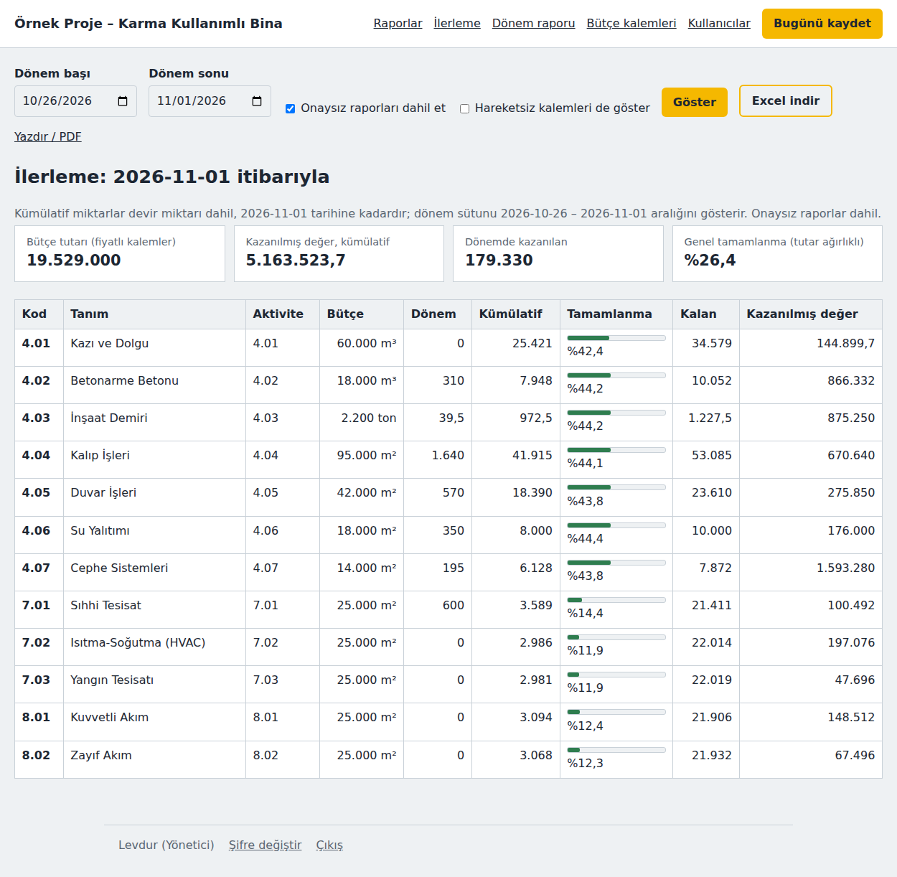

# Şantiye Günlüğü

Sahadaki personelin telefondan **bütçe kodlarına bağlı** günlük imalat ve işçilik verisi girdiği, ofisin bu veriyle bütçe ve iş programı ilerlemesini takip ettiği bir web uygulaması.

*A Flask + SQLite web app for construction sites: field staff log daily work quantities against budget cost codes from their phones; the office tracks progress, earned value and exports clean data for budgeting and scheduling.*



## Veri akışı

| Adım | Kim | Ne olur |
|---|---|---|
| 1 | Ofis | Bütçe kalemlerini (kod, tanım, birim, bütçe miktarı, birim fiyat, aktivite kodu, devir miktarı) Excel (.xlsx/.xlsm) veya CSV'den içe aktarır. Bütçe sayfası çok sayfalı dosyada otomatik bulunur; iki dilli başlıklar ve sayı olarak tutulan poz numaraları tanınır. |
| 2 | Saha personeli | Günlük rapor girer: imalat satırları (bütçe kodu listeden seçilir, birim otomatik gelir), sınıf bazında işçilik, notlar, fotoğraflar |
| 3 | Yönetici | Raporu kontrol eder ve onaylar; onaylanan rapor kilitlenir |
| 4 | Ofis / yönetici | İlerleme tablosu ve Excel dışa aktarma; varsayılan olarak yalnızca onaylı veri |

## Roller

| Rol | Yetki |
|---|---|
| Yönetici | Her şey: onay, silme, kullanıcı yönetimi, bütçe kalemleri |
| Ofis (bütçe/planlama) | Tüm raporları, ilerlemeyi görür, Excel indirir, bütçe kalemlerini yönetir; rapor giremez ve değiştiremez |
| Saha personeli | Günlük rapor girer, onaylanmamış raporu düzenler |

## Çıktılar

- **İlerleme:** kod bazında bütçe, dönem, kümülatif miktar, % tamamlanma, kalan, bütçe aşımı uyarısı; birim fiyat varsa kazanılmış değer ve tutar ağırlıklı genel tamamlanma
- **Excel dışa aktarma:** `Imalat` (her satır: tarih, bütçe kodu, miktar, lokasyon, aktivite kodu, tutar), `Iscilik`, `Ilerleme`, `IsProgrami` (aktivite bazında fiziksel %, ilk/son imalat tarihi), `Gunluk` sayfaları. Pivot tablolara ve iş programı güncellemesine (P6, MS Project, Excel) hazır uzun format.
- **Dönem raporu:** gün gün imalat ve işçilik, sınıf bazında adam-gün, isteğe bağlı fotoğraflar; tarayıcıdan PDF

## Veri kalitesi kuralları

- Saha yalnızca ofisin tanımladığı aktif kodları kullanabilir; birim koddan gelir
- Miktar sıfırdan büyük olmalı; ileri tarihe rapor girilemez; imalatsız günlerde neden yazılmalı
- Sahadan veri girilmiş bir kalemin birimi içe aktarmada değiştirilemez
- Devam eden projelerde sistem öncesi yapılmış miktar "devir miktarı" olarak girilir ve kümülatife eklenir
- Götürü (gtr) ve aylık (ay) kalemler varsayılan olarak saha listesine kapalı yüklenir
- Fotoğraflar küçültülür, konum bilgisi silinir

## Kendi bilgisayarında çalıştırma

```bash
python3 -m venv .venv
source .venv/bin/activate          # Windows: .venv\Scripts\activate
pip install -r requirements-dev.txt
flask --app app kullanici-ekle --yonetici
python app.py                      # http://127.0.0.1:5050
```

Testler: `pytest`

## İnternette yayınlama

PythonAnywhere için adım adım rehber: [KURULUM.md](KURULUM.md)

## Yol haritası

- [ ] Makine saatleri (çalışma/bekleme) bütçe koduna bağlı
- [ ] Birim başına adam-saat (verimlilik) ve bütçe varsayımıyla karşılaştırma
- [ ] Gecikme kaydı (neden, etkilenen kod, kayıp saat)
- [ ] Planlanan–gerçekleşen karşılaştırması ve S-eğrisi
- [ ] Birden fazla şantiye

## Lisans

MIT
